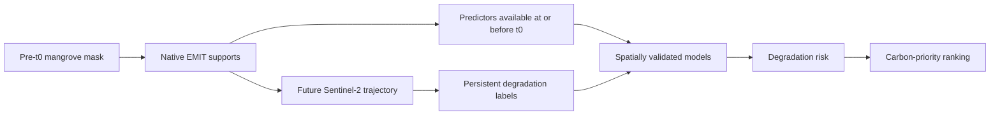
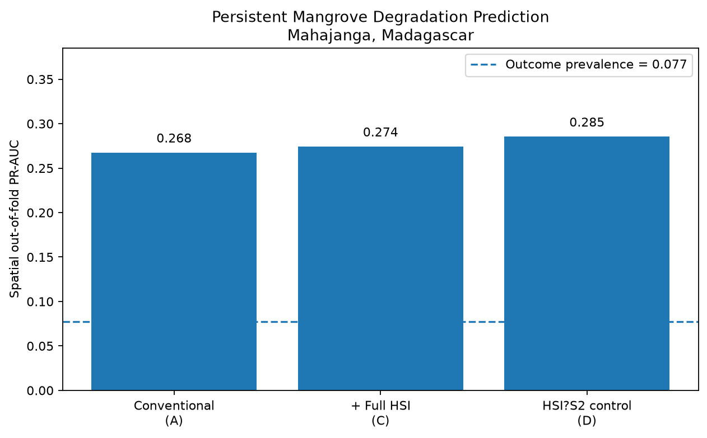

# Seeing Mangrove Loss Before It Happens

**Team Grand Spiral · Palestine · Arab Youth Space Hackathon 2026 · Challenge 813 · Blue Carbon & Mangrove Health**

A reproducible proof of concept that predicts persistent mangrove degradation before conventional Sentinel-2 confirmation, prioritizes carbon at risk, and tests whether NASA EMIT hyperspectral information adds predictive value.

**Headline:** degradation is predictable above prevalence from data available at the prediction date (PR-AUC 0.267 vs prevalence 0.077). An incremental hyperspectral advantage is **not established** (C − A = +0.007, 95% CI [−0.037, +0.061]).

---

## 1. Business use case

**Users:** environmental agencies and coastal regulators, blue-carbon project developers and verifiers, mangrove restoration programmes, and remote-sensing teams. For example, the UAE aims to plant 100 million mangroves by 2030 ([WAM, 2021](https://www.wam.ae/en/details/1395302990634)).

**Decision:** where to send limited monitoring and intervention resources first, before degradation is conventionally confirmed.

**What is used today:** annual or multi-year mangrove extent-change products, visual inspection of satellite imagery, field patrols and conventional multispectral vegetation indices. These mostly record loss after it has happened.

**What this PoC provides:** degradation-risk estimates for mangrove pixels, built only from data available at the prediction date, that can be combined with carbon stock to rank high-value areas for earlier intervention.

---

## 2. The problem

- Mangroves covered about **147,359 km²** in 2020, after a net loss of about **5,245 km² (−3.4%) since 1996** ([Bunting et al., 2022](https://doi.org/10.3390/rs14153657)).
- Per hectare they can store **up to four times more carbon** than most tropical forests, and their loss can account for **up to 10% of emissions from global deforestation** ([Donato et al., 2011](https://doi.org/10.1038/ngeo1123)).
- Long, remote coastlines are difficult to monitor in the field. Multispectral satellites observe often, but persistent degradation usually needs repeated cloud-free observations before it can be confirmed.
- Hyperspectral sensors measure narrow spectral features linked to leaf pigments and canopy water status, which may change before canopy loss is visible. This project tests whether that information improves early prediction in practice.

---

## 3. Data used

| Dataset | Provider | Date / period used | Processing level / resolution | Role | Licence |
|---|---|---|---|---|---|
| EMIT L2A Surface Reflectance V001 | NASA JPL / LP DAAC | Madagascar: `EMIT_L2A_RFL_001_20231227T092843_2336106_021`, t0 = 2023-12-27. Saudi Red Sea external test: `EMIT_L2A_RFL_001_20230330T094159_2308907_012` | L2A surface reflectance, ~60 m, 285 original bands | Hyperspectral predictors | NASA open data |
| Sentinel-2 MSI L2A | ESA Copernicus, accessed via Microsoft Planetary Computer | Up to 24 months before and 24 months after t0 | L2A bottom-of-atmosphere reflectance, 10–20 m | Conventional predictors before t0; outcome monitoring after t0 | Copernicus open licence |
| Global Mangrove Watch v3.0 | GMW consortium ([Zenodo 6894273](https://zenodo.org/record/6894273)) | 2020 | Mangrove extent | Pre-t0 mangrove mask; supports require ≥ 75% mangrove cover | CC BY 4.0 |
| Mangrove soil carbon, 0–100 cm | Sanderman et al. ([Zenodo 7727569](https://zenodo.org/records/7727569)) | Model year 2000 | 30 m, Mg C/ha | Carbon-priority analysis only; never a model input | CC BY-SA 4.0 |
| Sentinel-2 spectral response functions | ESA | Version 4.0 | Official band-response curves | Spectral-resolution control (D) | ESA public document |
| GOT4.10c ocean tide model | NASA GSFC, via pyTMD | Sentinel-2 observation dates | Modelled tide height | Label diagnostic only | NASA GSFC model; pyTMD MIT licence |

This public repository contains compact derived data and a small EMIT example clip (see `data_manifest.json`). Full satellite scenes, credentials, intermediate rasters and model weights are not committed.

---

## 4. Technical approach



Execution order:

1. **Pre-specification.** The label rules, cohort rules, primary hypothesis and validation design were frozen in `results/feasibility/analysis_plan.md` before any positive was counted or any model was fitted. The hash of the frozen text is in `results/feasibility/analysis_plan_sha256.txt`. Later changes are dated amendments appended to the plan.
2. **Prediction date.** EMIT acquisition on 27 December 2023.
3. **Cohort.** One sample per native EMIT support with ≥ 75% GMW-2020 mangrove cover. Supports already detected as degraded before t0 are excluded.
4. **Conventional predictors.** Sentinel-2 observations at or before t0 only, including near-t0 NDVI, NDMI, NDRE, CIre and MNDWI indices and historical NDVI/NDMI context.
5. **Hyperspectral predictors.** 285 original EMIT bands, of which 229 are retained after QA (425.5–2448.6 nm). The physiological spectral features are described in `docs/spectral_features.md`.
6. **Outcome.** Sentinel-2 observations after t0 only, over a fixed 24-month horizon. Persistent degradation requires repeated degraded observations, following the frozen rule in the analysis plan.
7. **Feature sets.**
   - A = conventional baseline.
   - C = A + full retained EMIT spectrum. This is the primary comparison against A.
   - D = A + the EMIT spectrum convolved to the official Sentinel-2 response functions. This control has the same date and sensor but only broad bands.
8. **Primary model.** L2-regularized logistic regression. Hyperparameters and PCA are fitted inside training folds only.
9. **Validation.**
   - 5 grouped spatial folds of 1 km spatial blocks, with a 60 m buffer and grouped positive patches.
   - Pooled spatial out-of-fold PR-AUC.
   - Paired spatial-block bootstrap with 1,000 draws, seed 813.
10. **Decision layer.** Predicted degradation risk can be combined with carbon stock to prioritize intervention.

No post-t0 information is used as a predictor, and carbon never enters a degradation model.

---

## 5. Installation

Tested with **Python 3.11.9** on Windows 10. **No GPU and no credentials are required.**

```bash
git clone https://github.com/Alaa-Awashra/mangrove-early-warning-813.git
cd mangrove-early-warning-813
python -m venv .venv
```

Windows PowerShell:

```powershell
.venv\Scripts\Activate.ps1
```

If activation is blocked, run `Set-ExecutionPolicy -Scope CurrentUser RemoteSigned` once.

Linux/macOS:

```bash
source .venv/bin/activate
```

Install all pinned dependencies:

```bash
python -m pip install -r requirements.txt
```

---

## 6. How to run

Certified public workflow: **clone → install → run the notebook or `python reproduce.py` → `HEADLINE CHECK: PASS`**.

**Option A: notebook**

```bash
jupyter lab notebooks/02_main_analysis.ipynb
```

- Choose **Restart Kernel and Run All Cells**. Nothing needs editing.
- The notebook reads `data/sample_input/model_cohort.parquet` and `data/sample_input/example_emit_clip.tif`.
- It refits the A, C and D logistic-regression configurations from scratch and recomputes the headline statistics and paired bootstrap comparisons.
- It writes `results/example_output.png`.
- Typical runtime is under 2 minutes on a standard laptop.

The final notebook output should show:

```text
HEADLINE CHECK: PASS
```

**Option B: terminal**

```bash
python reproduce.py
```

It compares the reproduced values with the frozen values in `reproducibility/expected_headline.json`. Expected final line:

```text
HEADLINE CHECK: PASS
```

**Automated tests**

```bash
python -m pytest -q
```

Public test status: **42 passed, 3 skipped**. The 3 skipped tests check artifacts that exist only in the full internal pipeline and are not part of this public package.

---

## 7. Example input and output

### Example input (`data/sample_input/`)

| File | Contents |
|---|---|
| `model_cohort.parquet` | Frozen Madagascar binary modelling cohort: 2,220 native supports, 172 persistent degradation events, 2,048 stable supports, 97 positive spatial patches |
| `example_emit_clip.tif` | Small 229-band EMIT example clip (created by `scripts/create_example_emit_clip.py`) |
| `saudi_binary_cohort.parquet` | Supplementary Saudi Red Sea external-test cohort; not required for the headline reproduction |

### Example output

Running the notebook creates `results/example_output.png`:



---

## 8. Results and limitations

### Headline result (Madagascar, pooled spatial out-of-fold)

| Model | PR-AUC |
|---|---:|
| Conventional Sentinel-2 baseline (A) | 0.267 |
| Conventional + full EMIT spectrum (C) | 0.274 |
| Hyperspectral-to-Sentinel-2 control (D) | 0.285 |
| Outcome prevalence | 0.077 |

| Comparison | Difference | 95% CI |
|---|---:|---:|
| C − A (primary, pre-specified) | +0.007 | [−0.037, +0.061] |
| C − D (full spectrum vs Sentinel-2-band control) | −0.011 | [−0.042, +0.028] |

**Strict spatial CV** (nearby events merged into one group): conventional A PR-AUC = **0.187 [0.094, 0.278]**, still above prevalence. Source: `results/addendum/A1_claim1_robustness.csv`.

**Interpretation:** persistent degradation was predictable above prevalence, but an incremental predictive value from 60 m EMIT hyperspectral data was not established.

### Secondary analyses (evidence files in this repository)

| Finding | Evidence |
|---|---|
| Median system lead time of about **82 days** before real-time Sentinel-2 confirmation | `results/addendum/A3_system_lead_time.csv`, `results/tables/early_warning_realtime.csv` |
| Alert comparisons at 5/10/20% budgets, including equal alert volume | `results/tables/incremental_warning_inference.csv` |
| Risk × carbon prioritization **outperformed random** targeting; an advantage over **carbon-only** targeting was **not established** | `results/tables/carbon_targeting.csv`, `results/tables/carbon_targeting_uncertainty.csv`, `results/addendum/A2_carbon_capture_paired.csv` |
| Loss-to-water outcomes were strongly **tide-associated** (55 of 96 such events observed only at high tide) | `results/tables/tide_diagnostic.json`, `results/tables/tide_loss_to_water_diagnostic.csv` |
| Small Saudi Red Sea external test: weak cross-region transfer (LR A PR-AUC 0.136 [0.015, 0.432]) and no hyperspectral improvement (C − A = −0.081 [−0.275, +0.025]) | `results/replication/arab/external_test_metrics.csv`, `results/replication/arab/external_test_paired.csv` |
| Spatial-CV robustness checks | `results/tables/robustness_spatial_cv.csv` |

### How it was validated

- Frozen, hashed analysis plan with dated amendments (`results/feasibility/`).
- Spatial block cross-validation with grouped events and a buffer, plus a paired spatial-block bootstrap for every model difference.
- An independent code audit (`results/diagnostics/INDEPENDENT_AUDIT.md`). It reproduced the primary result and found one implementation issue in the detection date, documented in `results/diagnostics/T_DETECT_FINDING.md`. The fix changed the lead-time analysis from 672 to 82 days; the frozen labels and PR-AUC values were unchanged.
- Automated tests (42 passed, 3 skipped).

`results/SUMMARY.md` is the full write-up from the complete internal analysis. Some historical file paths referenced inside it belong to that full internal pipeline and are not included in this public package.

### Limitations

- One main training site and one hyperspectral acquisition at the primary prediction date.
- Labels are satellite-derived, not field-confirmed.
- EMIT's ~60 m pixels mix canopy, water and exposed sediment on narrow fringes.
- Loss-to-water labels may be tide-confounded.
- The carbon layer represents modelled year-2000 soil carbon.
- The Saudi external test contains only 19 persistent events.
- The 813 spectral-range analysis does not reproduce the future satellite's expected 20 m spatial resolution.
- Hyperspectral incremental performance was not statistically established.

---

## 9. Team, licence and attribution

### Team Grand Spiral, Palestine

| Member | Role |
|---|---|
| **Alaa Awashra** | Data and machine-learning lead |
| **Rama Najjar** | Design, validation and product lead |
| **Mohey Aldeen Shami** | Remote sensing and spectroscopy lead |

Research design and review were conducted collaboratively.

### Licence

Project code is released under the [MIT License](LICENSE). Source datasets retain their original licences (section 3).

### Attribution

Built with data and tools from NASA EMIT / LP DAAC, ESA Copernicus Sentinel-2, Microsoft Planetary Computer, Global Mangrove Watch, Sanderman et al. mangrove soil-carbon data, NASA GSFC GOT4.10c, pyTMD, scikit-learn, PyTorch and rasterio.

Selected references:

- Bunting, P. et al. (2022). Global Mangrove Extent Change 1996–2020: Global Mangrove Watch Version 3.0. *Remote Sensing* 14, 3657.
- Sanderman, J. et al. (2018). A global map of mangrove forest soil carbon at 30 m spatial resolution. *Environmental Research Letters* 13, 055002.
- Green, R. O. (2022). EMIT L2A Estimated Surface Reflectance and Uncertainty and Masks 60 m V001. NASA LP DAAC. doi:10.5067/EMIT/EMITL2ARFL.001.
- Donato, D. C. et al. (2011). Mangroves among the most carbon-rich forests in the tropics. *Nature Geoscience* 4, 293–297.
- WAM (2021). UAE announces enhanced target to plant 100 million mangroves by 2030 at COP26.

### Repository map

| Path | Contents |
|---|---|
| `notebooks/02_main_analysis.ipynb` | Main reproducible notebook |
| `reproduce.py`, `reproducibility/expected_headline.json` | Terminal headline check and frozen expected values |
| `data/sample_input/`, `data_manifest.json` | Example inputs and their provenance |
| `src/`, `tests/` | Pipeline modules and automated tests |
| `results/` | Example output, frozen plan, audit, summary and evidence tables |
| `docs/spectral_features.md` | Description of the hyperspectral features |
| `run.py`, `config.yaml` | Entry point and configuration of the full internal pipeline, kept for transparency. It needs raw satellite data that are not included and is not part of the public reproduction workflow |
