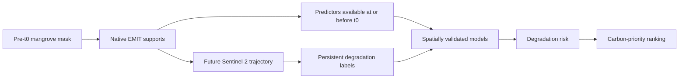

# Seeing Mangrove Loss Before It Happens

**Team Grand Spiral · Palestine · Arab Youth Space Hackathon 2026 · Challenge 813 · Blue Carbon & Mangrove Health**

A reproducible proof of concept that predicts persistent mangrove degradation before conventional Sentinel-2 confirmation, prioritizes carbon at risk, and tests whether NASA EMIT hyperspectral information adds predictive value.

**Headline:** degradation is predictable above prevalence from data available at the prediction date (PR-AUC **0.267** vs prevalence **0.077**). An incremental hyperspectral advantage is **not established** (C − A = **+0.007**, 95% CI **[−0.037, +0.061]**).

## Start here — what should I look at?

If you only have two minutes:

```bash
python reproduce.py
```

A successful reproduction ends with:

```text
HEADLINE CHECK: PASS
```

**Important:** `HEADLINE CHECK: PASS` means the repository successfully reproduced the frozen scientific result. It does **not** mean that the hyperspectral hypothesis was proven.

The main scientific question is:

> **Does full hyperspectral EMIT information improve prediction of future persistent mangrove degradation beyond a strong conventional Sentinel-2 baseline?**

The three primary configurations are:

| Label | What it uses | Spatial OOF PR-AUC |
|---|---|---:|
| **A — Conventional baseline** | Sentinel-2 + pre-t0 conventional context | **0.267** |
| **C — Full HSI** | A + full retained EMIT hyperspectral spectrum | **0.274** |
| **D — HSI→S2 control** | A + EMIT spectrum reduced to Sentinel-2-like broad bands | **0.285** |
| Outcome prevalence | Positive-event rate in the modelling cohort | **0.077** |

Higher PR-AUC is better. All three model configurations are well above the 0.077 prevalence reference. However, C improves on A by only **+0.007**, with a 95% confidence interval of **−0.037 to +0.061**. Because that interval includes zero, the experiment does **not establish a unique incremental advantage from full 60 m EMIT hyperspectral information**.

**Plain-language conclusion:** the PoC shows that persistent mangrove degradation can be anticipated using information available before conventional confirmation. In this experiment, however, full-resolution hyperspectral information did not show a statistically established advantage over the strong conventional baseline.

The main visual output is `results/example_output.png`. Full validation, secondary analyses, limitations and evidence files are documented below.

---

## 1. Business use case

**Users:** environmental agencies and coastal regulators, blue-carbon project developers and verifiers, mangrove restoration programmes, and remote-sensing teams. For example, the UAE aims to plant 100 million mangroves by 2030 ([WAM, 2021](https://www.wam.ae/en/details/1395302990634)).

**Decision:** where to send limited monitoring, field-validation and intervention resources first, before degradation is conventionally confirmed.

**What is used today:** annual or multi-year mangrove extent-change products, visual inspection of satellite imagery, field patrols and conventional multispectral vegetation indices. These approaches often confirm visible stress or extent change only after degradation is already underway.

**What this PoC provides:** degradation-risk estimates for native EMIT satellite supports (~60 m), built only from data available at the prediction date. Those risk estimates can then be combined with carbon stock to rank high-value areas for earlier intervention.

---

## 2. The problem

- Mangroves covered about **147,359 km²** in 2020, after a net loss of about **5,245 km² (−3.4%) since 1996** ([Bunting et al., 2022](https://doi.org/10.3390/rs14153657)).
- Per hectare they can store **up to four times more carbon** than most tropical forests, and their loss can account for **up to 10% of emissions from global deforestation** ([Donato et al., 2011](https://doi.org/10.1038/ngeo1123)).
- Long, remote coastlines are difficult to monitor continuously in the field.
- Multispectral satellites observe frequently, but persistent degradation generally needs repeated valid observations before it can be confirmed.
- Hyperspectral sensors measure narrow spectral features associated with pigments, canopy water status and other vegetation properties that may change before obvious canopy loss. This project tests whether those measurements improve early prediction in practice.

---

## 3. Data used

| Dataset | Provider | Date / period used | Processing level / resolution | Role | Licence |
|---|---|---|---|---|---|
| EMIT L2A Surface Reflectance V001 | NASA JPL / LP DAAC | Madagascar: `EMIT_L2A_RFL_001_20231227T092843_2336106_021`, t0 = 2023-12-27. Saudi Red Sea external test: `EMIT_L2A_RFL_001_20230330T094159_2308907_012` | L2A surface reflectance, ~60 m, 285 original bands | Hyperspectral predictors | NASA open data |
| Sentinel-2 MSI L2A | ESA Copernicus, accessed via Microsoft Planetary Computer | Up to 24 months before and 24 months after t0 | L2A bottom-of-atmosphere reflectance, 10–20 m | Conventional predictors before t0; outcome monitoring after t0 | Copernicus open licence |
| Global Mangrove Watch v3.0 | GMW consortium ([Zenodo 6894273](https://zenodo.org/record/6894273)) | 2020 | Mangrove extent | Pre-t0 mangrove mask; supports require ≥75% mangrove cover | CC BY 4.0 |
| Mangrove soil carbon, 0–100 cm | Sanderman et al. ([Zenodo 7727569](https://zenodo.org/records/7727569)) | Model year 2000 | 30 m, Mg C/ha | Carbon-priority analysis only; never a model input | CC BY-SA 4.0 |
| Sentinel-2 spectral response functions | ESA | Version 4.0 | Official band-response curves | Spectral-resolution control (D) | ESA public document |
| GOT4.10c ocean tide model | NASA GSFC, via pyTMD | Sentinel-2 observation dates | Modelled tide height | Label diagnostic only | NASA GSFC model; pyTMD MIT licence |

This public repository contains compact derived data and a small EMIT example clip (see `data_manifest.json`). Full satellite scenes, credentials, intermediate rasters and model weights are intentionally not committed.

---

## 4. Technical approach



Execution order:

1. **Pre-specification.** Label rules, cohort rules, the primary hypothesis and validation design were frozen in `results/feasibility/analysis_plan.md` before any positive was counted or any model was fitted. The hash of the frozen text is stored in `results/feasibility/analysis_plan_sha256.txt`. Later changes are recorded as dated amendments.
2. **Prediction date.** EMIT acquisition on 27 December 2023.
3. **Cohort.** One sample per native EMIT support with ≥75% GMW-2020 mangrove cover. Supports already detected as degraded before t0 are excluded.
4. **Conventional predictors (A).** Sentinel-2 observations at or before t0 only.
   - Near-t0 state uses the latest valid observation within 60 days before t0, Sentinel-2 bands, and the verified indices **NDVI, NDMI, NDRE, CIre and MNDWI**.
   - Historical NDVI/NDMI context covers the 24 months before t0.
5. **Hyperspectral predictors.** EMIT provides 285 original bands; 229 are retained after QA, spanning 425.5–2448.6 nm. Additional physical spectral features are described in `docs/spectral_features.md`.
6. **Outcome.** Sentinel-2 observations after t0 only, over a fixed 24-month horizon. Persistent degradation requires repeated degraded observations according to the frozen rule in the analysis plan.
7. **Feature sets.**
   - **A** = conventional baseline.
   - **C** = A + full retained EMIT spectrum. This is the primary comparison against A.
   - **D** = A + the EMIT spectrum convolved to the official Sentinel-2 response functions. This keeps the same EMIT acquisition date while reducing the spectrum to broad Sentinel-2-like bands.
8. **Primary model.** L2-regularized logistic regression.
   - Regularization strength: **C ∈ {0.01, 0.1, 1}**, selected by inner grouped cross-validation using average precision.
   - Hyperspectral bands are reduced by PCA to **at most 10 components**.
   - Imputation, scaling, PCA, class weights and C selection are all fitted inside training folds only.
9. **Validation.**
   - 5 grouped spatial folds.
   - 1 km spatial blocks.
   - 60 m buffer.
   - Grouped positive patches.
   - Primary metric: pooled spatial out-of-fold PR-AUC.
   - Paired spatial-block bootstrap: 1,000 draws, seed 813.
10. **Decision layer.** Predicted degradation risk can be combined with carbon stock to prioritize intervention.

**Leakage control:** no post-t0 information is used as a predictor, and carbon never enters a degradation model.

---

## 5. Installation

Tested with **Python 3.11.9** on Windows 10. **No GPU and no credentials are required for the public reproduction workflow.**

```bash
git clone https://github.com/Alaa-Awashra/mangrove-early-warning-813.git
cd mangrove-early-warning-813
python -m venv .venv
```

Windows PowerShell:

```powershell
.venv\Scripts\Activate.ps1
```

If activation is blocked, run this once:

```powershell
Set-ExecutionPolicy -Scope CurrentUser RemoteSigned
```

Linux/macOS:

```bash
source .venv/bin/activate
```

Install all pinned dependencies:

```bash
python -m pip install -r requirements.txt
```

---

## 6. How to run

### Fastest verification

If you want to verify the headline result immediately:

```bash
python reproduce.py
```

Typical runtime is about **20–30 seconds** on a standard laptop.

The script refits the Madagascar A, C and D logistic-regression configurations and compares the reproduced statistics with the frozen expected values in `reproducibility/expected_headline.json`.

Expected final line:

```text
HEADLINE CHECK: PASS
```

Again, `PASS` means **the frozen result was reproduced successfully**. It does not mean that model C significantly outperformed model A.

### Main Jupyter notebook

```bash
jupyter lab notebooks/02_main_analysis.ipynb
```

Then choose **Restart Kernel and Run All Cells**.

The notebook:

- uses relative paths;
- reads the committed sample inputs;
- refits A, C and D from scratch;
- recomputes the headline PR-AUC values and paired bootstrap comparisons;
- regenerates `results/example_output.png`;
- ends with `HEADLINE CHECK: PASS`.

Typical runtime is **under 2 minutes** on a standard laptop.

### Automated tests

```bash
python -m pytest -q
```

Current public test status:

```text
42 passed, 3 skipped
```

To display the reason for each expected skip:

```bash
python -m pytest -q -rs
```

The current skips correspond to public-package conditions where the official SRF workbook is not prepared, no full research model is fitted for that test path, or full Tier 1 artifacts are not present.

---

## 7. Example input and output

### Example input (`data/sample_input/`)

| File | Contents |
|---|---|
| `model_cohort.parquet` | Frozen Madagascar binary modelling cohort: 2,220 native supports, 172 persistent degradation events, 2,048 stable supports, 97 positive spatial patches |
| `example_emit_clip.tif` | Small 229-band EMIT example clip created by `scripts/create_example_emit_clip.py` |
| `saudi_binary_cohort.parquet` | Supplementary Saudi Red Sea external-test cohort; not required for the headline reproduction |

### Example output

Running the notebook regenerates:

`results/example_output.png`


### How to read this figure

- The dashed line at **0.077** is the positive-event prevalence.
- Higher PR-AUC indicates better ranking of persistent degradation events.
- **A = 0.268** in the regenerated figure: conventional Sentinel-2 baseline.
- **C = 0.274**: conventional baseline plus full EMIT hyperspectral information.
- **D = 0.285**: EMIT information reduced to Sentinel-2-like broad bands.

The key comparison is **C versus A**, not simply which bar is tallest. C is only slightly above A, and the paired uncertainty interval for C − A includes zero.

**Therefore:** the models predict persistent degradation above prevalence, but this experiment does **not** establish that the full hyperspectral spectrum adds predictive value beyond the conventional baseline.

The slight display difference between **0.268** in the regenerated plot and **0.267** in the frozen headline table is due to rounding of the reproduced value; the reproduction script compares against the frozen values within the pre-defined tolerance.

---

## 8. Results and limitations

### Headline result — Madagascar, pooled spatial out-of-fold evaluation

| Model | PR-AUC |
|---|---:|
| Conventional Sentinel-2 baseline (A) | **0.267** |
| Conventional + full EMIT spectrum (C) | **0.274** |
| Hyperspectral-to-Sentinel-2 control (D) | **0.285** |
| Outcome prevalence | **0.077** |

| Comparison | Difference | 95% CI |
|---|---:|---:|
| C − A — primary pre-specified comparison | **+0.007** | **[−0.037, +0.061]** |
| C − D — full spectrum vs Sentinel-2-band control | **−0.011** | **[−0.042, +0.028]** |

**Strict spatial CV:** when nearby events are merged into one group, conventional A PR-AUC is **0.187 [0.094, 0.278]**, still above prevalence. Evidence: `results/addendum/A1_claim1_robustness.csv`.

### What the result means

The project supports one conclusion and does not support another:

**Supported by this PoC:** future persistent mangrove degradation can be predicted above prevalence using information available before conventional confirmation.

**Not established by this PoC:** that adding the full 60 m EMIT hyperspectral spectrum provides incremental predictive value beyond the conventional Sentinel-2 baseline.

That distinction is the central scientific result of the project.

### Secondary analyses

| Finding | Evidence |
|---|---|
| Median system lead time of about **82 days** before real-time Sentinel-2 confirmation | `results/addendum/A3_system_lead_time.csv`, `results/tables/early_warning_realtime.csv` |
| Alert comparisons at 5/10/20% budgets, including equal realized alert volume | `results/tables/incremental_warning_inference.csv` |
| Risk × carbon prioritization **outperformed random** targeting; an advantage over **carbon-only** targeting was **not established** | `results/tables/carbon_targeting.csv`, `results/tables/carbon_targeting_uncertainty.csv`, `results/addendum/A2_carbon_capture_paired.csv` |
| Loss-to-water outcomes were strongly **tide-associated**: for 55 of 96 events, every qualifying loss-to-water observation occurred within the top tide quartile | `results/tables/tide_diagnostic.json`, `results/tables/tide_loss_to_water_diagnostic.csv` |
| Small Saudi Red Sea external test: weak cross-region transfer — LR A PR-AUC 0.136 [0.015, 0.432] — and no hyperspectral improvement — C − A = −0.081 [−0.275, +0.025] | `results/replication/arab/external_test_metrics.csv`, `results/replication/arab/external_test_paired.csv` |
| Spatial-CV robustness checks | `results/tables/robustness_spatial_cv.csv` |

### How it was validated

- Frozen, hashed analysis plan with dated amendments in `results/feasibility/`.
- Strict temporal separation between predictors and future outcome observations.
- Grouped spatial cross-validation and a spatial buffer.
- Paired spatial-block bootstrap for model differences.
- Fold-local preprocessing and hyperparameter selection.
- Carbon excluded from all degradation-prediction models.
- Independent code audit in `results/diagnostics/INDEPENDENT_AUDIT.md`.
- Detection-date issue identified and documented in `results/diagnostics/T_DETECT_FINDING.md`.
- The lead-time correction changed the operational lead estimate from 672 to **82 days**, while the frozen labels and headline PR-AUC values remained unchanged.
- Automated tests: **42 passed, 3 skipped, 0 failed**.

`results/SUMMARY.md` is the full write-up from the complete internal analysis. Some historical paths referenced inside it belong to the full internal pipeline and are intentionally not included in this compact public package.

### Limitations

- One main training site and one hyperspectral acquisition at the primary prediction date.
- Labels are satellite-derived rather than field-confirmed.
- EMIT's ~60 m supports can mix canopy, water and exposed sediment along narrow mangrove fringes.
- Loss-to-water outcomes may be tide-confounded.
- The carbon layer represents modelled year-2000 soil carbon.
- The Saudi external test contains only 19 persistent events.
- The 813 spectral-range analysis does not reproduce the future satellite's expected 20 m spatial resolution.
- Hyperspectral incremental performance was not statistically established.

---

## 9. Team, licence and attribution

### Team Grand Spiral, Palestine

| Member | Role |
|---|---|
| **Alaa Awashra** | Data and machine-learning lead |
| **Rama Najjar** | Design, validation and product lead |
| **Mohey Aldeen Shami** | Remote sensing and spectroscopy lead |

Research design and review were conducted collaboratively.

### Licence

Project code is released under the [MIT License](LICENSE). Source datasets retain their original licences listed in section 3.

### Attribution

Built with data and tools from NASA EMIT / LP DAAC, ESA Copernicus Sentinel-2, Microsoft Planetary Computer, Global Mangrove Watch, Sanderman et al. mangrove soil-carbon data, NASA GSFC GOT4.10c, pyTMD, scikit-learn, PyTorch and rasterio.

Selected references:

- Bunting, P. et al. (2022). Global Mangrove Extent Change 1996–2020: Global Mangrove Watch Version 3.0. *Remote Sensing* 14, 3657.
- Sanderman, J. et al. (2018). A global map of mangrove forest soil carbon at 30 m spatial resolution. *Environmental Research Letters* 13, 055002.
- Green, R. O. (2022). EMIT L2A Estimated Surface Reflectance and Uncertainty and Masks 60 m V001. NASA LP DAAC. doi:10.5067/EMIT/EMITL2ARFL.001.
- Donato, D. C. et al. (2011). Mangroves among the most carbon-rich forests in the tropics. *Nature Geoscience* 4, 293–297.
- WAM (2021). UAE announces enhanced target to plant 100 million mangroves by 2030 at COP26.

### Repository map

| Path | Contents |
|---|---|
| `notebooks/02_main_analysis.ipynb` | Main reproducible notebook |
| `reproduce.py`, `reproducibility/expected_headline.json` | Fast terminal reproduction and frozen expected values |
| `data/sample_input/`, `data_manifest.json` | Compact example inputs and provenance |
| `src/`, `tests/` | Pipeline modules and automated tests |
| `results/` | Example output, frozen plan, audit, summary and evidence tables |
| `docs/spectral_features.md` | Description of hyperspectral features |
| `run.py`, `config.yaml` | Legacy/internal reference material retained because the public tests inspect the frozen plan through `run.py`; not part of the certified public reproduction workflow |

---

## Reviewer shortcut

For the shortest complete verification:

```bash
git clone https://github.com/Alaa-Awashra/mangrove-early-warning-813.git
cd mangrove-early-warning-813
python -m venv .venv
# activate the environment
python -m pip install -r requirements.txt
python reproduce.py
```

Then confirm:

```text
HEADLINE CHECK: PASS
```

Finally, inspect:

- `results/example_output.png` for the main visual result;
- section **8. Results and limitations** for the scientific interpretation;
- `results/diagnostics/INDEPENDENT_AUDIT.md` for the independent audit;
- `results/SUMMARY.md` for the full analysis record.
